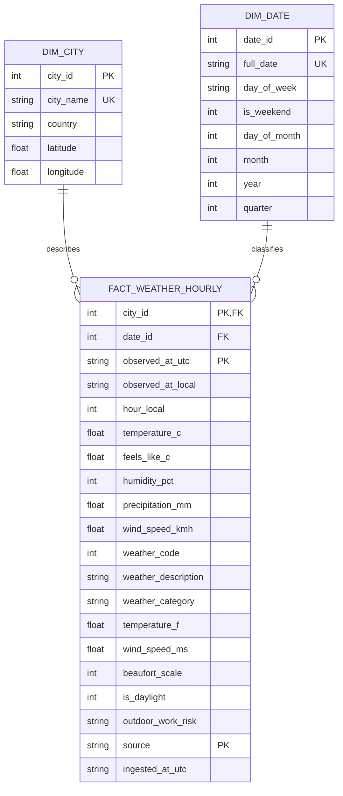

# WeatherFlow Star Schema

## Grain

One row per city, per hour, per source.

The fact table uses a composite primary key consisting of
city_id, observed_at_utc and source.

## Entity Relationship Diagram

## Dimension Tables

### dim_city

Stores descriptive information about each configured city.

city_id is a surrogate key assigned by SQLite.
city_name is the unique business key.

The city dimension is populated from config.yaml using upserts.

### dim_date

Contains one record for each calendar date in the configured
date range.

The date_id is an integer in YYYYMMDD format.

The dimension supports analytical grouping by weekday,
weekend, month, quarter and year.

The fact date_id is derived from the Europe/London local
observation date, not the UTC observation date.

For example, 23:00 UTC on 30 June 2026 corresponds to
00:00 on 1 July 2026 in London.

Its date_id is therefore 20260701.

## Fact Table

fact_weather_hourly stores weather measurements and derived
business metrics at the hourly grain.

Composite primary key:

- city_id
- observed_at_utc
- source

The source column allows forecast and historical observations
to coexist without overwriting one another.

City coordinates are stored in dim_city rather than repeated
in every hourly fact record.

## Referential Integrity

The fact table references dim_city and dim_date through
foreign keys.

Foreign key enforcement is explicitly enabled on every load
connection using PRAGMA foreign_keys = ON.

The configured date range must cover every observation date.

## Idempotency

The loader uses INSERT ... ON CONFLICT DO UPDATE.

Repeated loads of identical observation keys update the
existing records rather than creating duplicates.

Updated measurements and ingestion timestamps may change,
but the number of records remains unchanged for the same keys.

## Atomicity

Schema initialization, city dimension upserts, date dimension
upserts and fact upserts occur within one database transaction.

If an error occurs, all database changes from that transaction
are rolled back.

Raw JSON and processed Parquet files are retained independently
of the database transaction.

## Storage

Database: data/weather.db

Schema definition: sql/schema.sql

Analytical queries: sql/analysis_queries.sql

The original weather_hourly table is retained for historical
reference. New pipeline loads target fact_weather_hourly.
